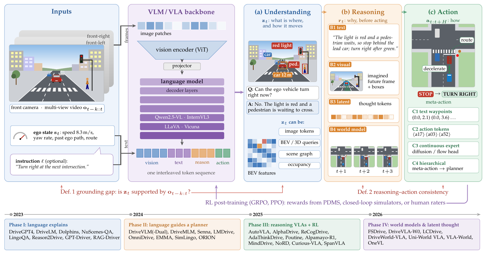
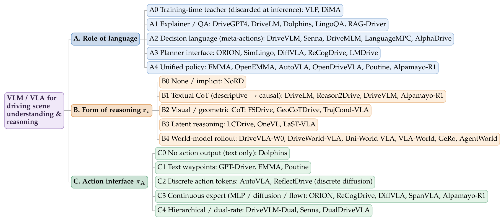

# From Seeing to Driving: A Survey of Vision-Language and Vision-Language-Action Models for Scene Understanding and Reasoning in Autonomous Driving

**Binay Kumar Singh** and **Niels Da Vitoria Lobo**  
Department of Computer Science, University of Central Florida

This repository accompanies our survey. It lists the papers we review, organized by our three-dimensional taxonomy, and collects the benchmark results and controlled comparisons reported in the survey. Values are copied from the original papers; no model was re-run.

> 📄 Paper: coming soon. If you find this repository useful, please consider citing the survey (see [Citation](#citation)).

<p align="center"></p>

## Contents
- [Research questions](#research-questions)
- [Key findings](#key-findings)
- [Taxonomy](#taxonomy)
- [Papers by role of language](#papers-by-role-of-language)
- [Datasets and benchmarks](#datasets-and-benchmarks)
- [Results: NAVSIM](#results-navsim)
- [Results: Bench2Drive](#results-bench2drive)
- [Results: WOD-E2E](#results-wod-e2e)
- [Controlled comparisons](#controlled-comparisons)
- [Related surveys](#related-surveys)
- [Citation](#citation)
- [Contributing](#contributing)

## Research questions
- **RQ1 (Understanding).** Is the scene understanding of driving VLMs grounded in the sensor input, and which design choices close the grounding gap?
- **RQ2 (Reasoning).** Which forms of reasoning improve driving, under which conditions, and is the stated reasoning faithful to the executed action?
- **RQ3 (Action and Training).** How do architectures and training recipes turn understanding and reasoning into driving, and which of them account for the reported gains?

We formalize existing systems with a unified **Understanding–Reasoning–Action (URA)** formulation: a scene representation **z**<sub>t</sub>, an optional reasoning trace **r**<sub>t</sub>, and an action **a**<sub>t:t+H</sub>, with two measurable properties: the *grounding gap* and *reasoning–action consistency*.

## Key findings
- **Finding 1 (RQ1): Grounding Is the Weakest Link.** A language model does not by itself solve scene understanding. VQA metrics can reward answers that ignore the image, degraded input widens the grounding gap, and driving fine-tuning can lower causal accuracy relative to the base VLM. Understanding results should be reported against a blind (text-only or corrupted-input) baseline.
- **Finding 2 (RQ1): Explicit Geometry Helps.** Injecting geometry through a spatial stream, BEV supervision, or geometric question answering gives consistent gains, and the best single policies on NAVSIM use such information. On saturated benchmarks the gains are small.
- **Finding 3 (RQ2): Train with Reasoning, Reason Selectively.** Reasoning supervision improves planning even without text at inference, whereas test-time reasoning adds no gain at 8.5× latency. Language helps on 14.5% of Bench2Drive routes and hurts on 23.6%. Explicit reasoning at inference is worth its cost mainly in rare and interactive scenes, and should be invoked adaptively.
- **Finding 4 (RQ2): Stated Reasoning Is Often Unfaithful.** Alpamayo-R1-10B reaches 48.3% reasoning–action consistency, and in 37.9% of the cases in which it states that it will stop, it continues. Observational and interventional measures can rank models in opposite order. Faithfulness should be measured by intervening on the reasoning trace, not by reading it.
- **Finding 5 (RQ3): VLM and Vision-Only Paths Are Complementary.** Vision-only encoders do better in geometry-dominated scenes and VLMs in semantically complex ones. A per-scene oracle reaches 93.58 PDMS against 90.80 for the VLM alone, a learned hybrid reaches 92.1, and calling the VLM in only 15% of scenes reaches 91.00 at about 1.9× lower latency. Pairing the VLM with an action expert or a fast vision-only path currently gives the best balance of accuracy and cost.
- **Finding 6 (RQ3): Training Recipe Matters More than Backbone Size.** Enlarging LaST-VLA from 2B to 8B adds 0.2 PDMS. On Bench2Drive, online RL raises the mean ability score of MindDrive from 49.44 to 56.94, and GRPO with generative rollouts raises the Success Rate by 26.2 points. The common 2026 recipe (open VLM, driving pre-training, staged fine-tuning, RL post-training) reflects this, and most recent gains come from how RL is applied rather than from new architectures.
- **Finding 7 (Evaluation): Small NAVSIM Gains Are Within Noise.** Single-factor gains of 0.2 to 1.1 PDMS from backbone scaling and geometric supervision are smaller than the 1.2-point gap between two reported versions of ReCogDrive (89.6 and 90.8), collision avoidance is saturated, and language-free planners match or exceed VLAs on aggregate scores. Claims about understanding and reasoning should be compared with a strong language-free planner and confirmed in closed loop, on long-tail scenarios, and over repeated runs.

## Taxonomy
Each method is classified along three independent dimensions: **A. role of language**, **B. form of reasoning**, and **C. action interface**.

<p align="center"></p>

| Dimension | Levels |
|---|---|
| A. Role of language | A0 training-time teacher · A1 explainer / QA · A2 decision language · A3 planner interface · A4 unified policy |
| B. Form of reasoning | B0 none / implicit · B1 textual CoT · B2 visual / geometric CoT · B3 latent · B4 world-model rollout |
| C. Action interface | C0 no action output · C1 text waypoints · C2 discrete action tokens · C3 continuous expert · C4 hierarchical / dual-rate |

"--" means the dimension is not specified or not applicable.

## Papers by role of language
### A0 — Training-time teacher (discarded at inference)

| Method | Venue | B (reasoning) | C (action) | Key idea |
|---|---|---|---|---|
| [VLP](https://doi.org/10.1109/CVPR52733.2024.01398) | CVPR'24 | -- | -- | Language priors enrich BEV features during training |
| DiMA | CVPR'25 | -- | -- | Distills an MLLM into a vision-based planner |

### A1 — Explainer / question answering

| Method | Venue | B (reasoning) | C (action) | Key idea |
|---|---|---|---|---|
| [DriveGPT4](https://doi.org/10.1109/LRA.2024.3440097) | RA-L'24 | B1 | -- | Interpretable video LLM that explains and predicts control |
| [DriveLM](https://doi.org/10.1007/978-3-031-72943-0_15) | ECCV'24 | B1 | C1 | Graph VQA linking perception, prediction and planning |
| [Dolphins](https://doi.org/10.1007/978-3-031-72995-9_23) | ECCV'24 | B1 | C0 | Instruction-tuned multimodal model for driving |
| [RAG-Driver](https://doi.org/10.15607/RSS.2024.XX.075) | RSS'24 | B1 | -- | Retrieval-augmented in-context explanations |
| [V2V-LLM](https://arxiv.org/abs/2502.09980) | arXiv'25 | -- | -- | Cooperative perception and planning QA across vehicles |
| [OmniDrive](https://doi.org/10.1109/CVPR52734.2025.02090) | CVPR'25 | B1 | C1 | 3D-grounded tokens; counterfactual reasoning |

### A2 — Decision language (meta-actions)

| Method | Venue | B (reasoning) | C (action) | Key idea |
|---|---|---|---|---|
| [LanguageMPC](https://arxiv.org/abs/2310.03026) | arXiv'23 | B1 | C4 | LLM decisions mapped to MPC parameters |
| DriveMLM | Vis. Intell.'25 | -- | C4 | Aligns MLLM outputs with behavioural planning states |
| DriveVLM | CoRL'24 | B1 | C4 | Describe–analyze–plan; dual system with E2E planner |
| [Senna](https://doi.org/10.1007/s11263-026-03002-y) | IJCV'26 | B1 | C4 | VLM meta-actions guide an end-to-end planner |
| Talk2Drive | ITSC'24 | -- | -- | Verbal commands to controls; personalization memory |
| [AlphaDrive](https://arxiv.org/abs/2503.07608) | arXiv'25 | B1 | -- | GRPO with planning rewards for meta-actions |
| MindDrive | ECCV'26 | -- | C3 | Online RL on language meta-actions; B2D DS 78.04 |

### A3 — Planner interface

| Method | Venue | B (reasoning) | C (action) | Key idea |
|---|---|---|---|---|
| [LMDrive](https://doi.org/10.1109/CVPR52733.2024.01432) | CVPR'24 | -- | C3 | Language-guided closed-loop driving |
| [SimLingo](https://doi.org/10.1109/CVPR52734.2025.01120) | CVPR'25 | -- | C3 | Language–action alignment; vision-only closed loop |
| ORION | ICCV'25 | B1 | C3 | QT-Former memory + generative planner; B2D DS 77.74 |
| [DiffVLA](https://arxiv.org/abs/2505.19381) | arXiv'25 | B1 | C3 | VLM guidance for a diffusion planner |
| ReCogDrive | ICLR'26 | B1 | C3 | Three-stage training; diffusion planner refined with RL |
| [IRL-VLA](https://arxiv.org/abs/2508.06571) | arXiv'25 | -- | C3 | RL against a reward world model learned by inverse RL |
| [DualDriveVLA](https://arxiv.org/abs/2602.10719) | arXiv'26 | -- | C4 | Vision-only by default; VLM invoked in 15% of scenes |

### A4 — Unified policy

| Method | Venue | B (reasoning) | C (action) | Key idea |
|---|---|---|---|---|
| GPT-Driver | NeurIPS-W'23 | B1 | C1 | Motion planning as language modeling |
| [EMMA](https://arxiv.org/abs/2410.23262) | arXiv'24 | B1 | C1 | Co-trains planning, 3D detection and road graph as text |
| [Atlas](https://arxiv.org/abs/2405.18361) | arXiv'24 | B1 | -- | DETR-style 3D tokenizers for the language model |
| [OpenDriveVLA](https://doi.org/10.1609/aaai.v40i16.38386) | AAAI'26 | -- | C1 | Structured 3D visual tokens for a VLA |
| AutoVLA | NeurIPS'25 | B1 | C2 | Action tokens, adaptive reasoning, RL fine-tuning |
| FSDrive | NeurIPS'25 | B2 | C1 | Visual spatio-temporal CoT from an imagined future frame |
| [Poutine](https://arxiv.org/abs/2506.11234) | arXiv'25 | B1 | C1 | VLT pre-training + GRPO; 1st in 2025 Waymo challenge |
| [AdaThinkDrive](https://arxiv.org/abs/2509.13769) | arXiv'25 | B1 | -- | Learns when to think via an adaptive-think reward |
| [Alpamayo-R1](https://arxiv.org/abs/2511.00088) | arXiv'25 | B1 | C3 | Chain-of-Causation reasoning; 99 ms on-vehicle latency |
| LCDrive | CVPR'26 | B3 | C2 | Latent CoT with action-proposal and world-model tokens |
| [LVLDrive](https://arxiv.org/abs/2512.24331) | arXiv'25 | -- | -- | LiDAR added via a gradual-fusion Q-Former |
| DriveVLA-W0 | ICLR'26 | B4 | C3 | Future-image prediction amplifies data scaling |
| NoRD | CVPR'26 | B0 | -- | No reasoning labels; Dr. GRPO against difficulty bias |
| [Curious-VLA](https://arxiv.org/abs/2603.06049) | CVPR-F'26 | B1 | -- | Fixes "narrow policy" to unlock RL exploration |
| [DriveWorld-VLA](https://arxiv.org/abs/2602.06521) | arXiv'26 | B4 | -- | World-model latents as decision variables |
| [Uni-World VLA](https://arxiv.org/abs/2603.27287) | arXiv'26 | B4 | -- | Interleaves future-frame prediction and planning |
| [OneVL](https://arxiv.org/abs/2604.18486) | arXiv'26 | B3 | -- | One-pass latent reasoning with explanation decoders |
| [SpanVLA](https://arxiv.org/abs/2604.19710) | arXiv'26 | B1 | C3 | Flow-matching expert; GRPO with negative and recovery samples |
| ReflectDrive | ICLR'26 | -- | C2 | Discrete diffusion with safety-aware reflection |
| LaST-VLA | NeurIPS'26 | B3 | -- | Geometry- and dynamics-aligned latent CoT |
| TrajCond-VLA | NeurIPS'26 | B2 | -- | Trajectory-geometric condition learned from reasoning |
| [GeRo](https://arxiv.org/abs/2601.11475) | arXiv'26 | B4 | -- | Language-grounded scenario rollouts with GRPO |
| [CLEAR](https://arxiv.org/abs/2607.02841) | arXiv'26 | -- | -- | Closed-loop RL at scale |
| [Qwen-Drive-1.0](https://arxiv.org/abs/2609.00111) | arXiv'26 | -- | C3 | BEV perception head and flow-matching planner on a VLM |
| [Geo-VLA](https://arxiv.org/abs/2608.21440) | arXiv'26 | -- | -- | Map semantics internalized via Geo-QA |
| [GeoCoTDrive](https://arxiv.org/abs/2610.10390) | arXiv'26 | B2 | -- | Explicit geometric chain of thought |
| [AgentWorld](https://arxiv.org/abs/2611.22880) | arXiv'26 | B4 | -- | Agent-centric world model with discrete agent tokens |

## Datasets and benchmarks
| Name | Venue | Built on | Loop | What it measures |
|---|---|---|---|---|
| multicolumn{5}{@{}l}{textit{Understanding, language and reasoning}} |
| [BDD-X](https://doi.org/10.1007/978-3-030-01216-8_35) | ECCV'18 | BDD | -- | Textual explanations of driving actions |
| [Talk2Car](https://doi.org/10.18653/v1/D19-1215) | EMNLP'19 | nuScenes | -- | Grounding natural-language commands |
| [DRAMA](https://doi.org/10.1109/WACV56688.2023.00110) | WACV'23 | own | -- | Risk localization and captioning |
| [NuScenes-QA](https://doi.org/10.1609/aaai.v38i5.28253) | AAAI'24 | nuScenes | -- | 3D scene VQA |
| [DriveLM](https://doi.org/10.1007/978-3-031-72943-0_15) | ECCV'24 | nuScenes, CARLA | open | Graph VQA from perception to planning |
| [LingoQA](https://doi.org/10.1007/978-3-031-72980-5_15) | ECCV'24 | own | -- | Free-form driving VQA with a learned metric |
| [Reason2Drive](https://doi.org/10.1007/978-3-031-73347-5_17) | ECCV'24 | multiple | -- | Chain-based reasoning |
| [OmniDrive](https://doi.org/10.1109/CVPR52734.2025.02090) | CVPR'25 | nuScenes | open | 3D-grounded, counterfactual QA |
| DriveLMM-o1 | IROS'25 | multi-view + LiDAR | -- | Step-by-step reasoning; scores steps and answer |
| [DriveMLLM](https://arxiv.org/abs/2411.13112) | arXiv'24 | nuScenes | -- | Absolute and relative spatial understanding |
| SURDS | NeurIPS'25 | nuScenes | -- | Six spatial categories; 9,250 eval. samples |
| DriveBench | ICCV'25 | nuScenes | -- | Reliability under 17 settings; 20,498 QA pairs |
| [DriveSpatial](https://arxiv.org/abs/2605.23176) | arXiv'26 | five datasets | -- | Spatiotemporal intelligence; 20 tasks, four abilities |
| TAD | ICML'26 | driving video | -- | Temporal understanding; ~6,000 QA pairs, 7 tasks |
| [DVBench](https://arxiv.org/abs/2504.14526) | arXiv'25 | driving video | -- | Safety-critical driving video understanding |
| [V2V-QA](https://arxiv.org/abs/2502.09980) | arXiv'25 | cooperative | -- | Grounding, notable objects, planning across vehicles |
| [VLADriveBench](https://arxiv.org/abs/2606.12706) | arXiv'26 | -- | -- | CoT–action relationship; observation + intervention |
| [nuReasoning](https://arxiv.org/abs/2605.31572) | arXiv'26 | own (4 US cities) | open | Long-tail reasoning VQA and planning; 20,000 clips |
| [CausalDriveBench](https://arxiv.org/abs/2609.32157) | arXiv'26 | nuScenes | open | Pearl's causal hierarchy; 7,285 causal QA pairs |
| multicolumn{5}{@{}l}{textit{Action and planning}} |
| [nuScenes planning](https://doi.org/10.1109/CVPR42600.2020.01164) | CVPR'20 | nuScenes | open | L2 error, collision rate (see~cite{li2024egostatus}) |
| [NAVSIM v1](https://doi.org/10.52202/079017-0902) | NeurIPS'24 | nuPlan / OpenScene | non-reactive | PDM score (PDMS) |
| NAVSIM v2 | CoRL'25 | nuPlan / OpenScene | pseudo-sim. | Extended PDMS (EPDMS) |
| [Bench2Drive](https://doi.org/10.52202/079017-0025) | NeurIPS'24 | CARLA | closed | Driving Score (DS), Success Rate (SR) |
| [Bench2Drive-VL](https://arxiv.org/abs/2604.01259) | arXiv'26 | CARLA | closed | Closed-loop VLM evaluation with behavior-grounded QA |
| WOD-E2E | CVPR'26 | Waymo | open | Rater Feedback Score (RFS); 4,021 long-tail segments |
| [Odyssey](https://arxiv.org/abs/2610.06469) | arXiv'26 | nuPlan, 3DGS | closed | Long-horizon route following; 100 scenarios of 100 s |
| [CoVLA](https://doi.org/10.1109/WACV61041.2025.00195) | WACV'25 | own | open | Large-scale VLA training data |

## Results: NAVSIM
NAVSIM v1 navtest (PDMS) and NAVSIM v2 (EPDMS). NC: no at-fault collision; DAC: drivable-area compliance; TTC: time-to-collision; Comf.: comfort; EP: ego progress. v1 and v2 scores are not directly comparable.

| Method | Venue | Backbone | Reasoning / training | NC↑ | DAC↑ | TTC↑ | Comf.↑ | EP↑ | PDMS↑ | EPDMS (v2)↑ |
|---|---|---|---|---|---|---|---|---|---|---|
| [SafeAlign-VLA](https://arxiv.org/abs/2605.19524) | arXiv'26 | Qwen2.5-VL-7B | B1; negative-aware RL | 98.6 | 97.2 | 98.1 | 100 | 81.7 | 89.1 | -- |
| AutoVLA | NeurIPS'25 | Qwen2.5-VL-3B | B1 adaptive; GRPO | 98.41 | 95.64 | 98.04 | 99.94 | 81.87 | 89.11 | -- |
| ↳ AutoVLA, best-of-N |  |  |  | 99.14 | 97.08 | 97.12 | 99.98 | 87.55 | 92.12 | -- |
| ReCogDrive (v1) | ICLR'26 | InternVL3-8B | Cognitive tokens; DiffGRPO | 98.2 | 97.8 | 95.2 | 99.8 | 83.5 | 89.6 | -- |
| ReCogDrive (v2) | ICLR'26 | InternVL3‡ | Cognitive tokens; DiffGRPO | 97.9 | 97.3 | 94.9 | 100 | 87.3 | 90.8 | -- |
| [AdaThinkDrive](https://arxiv.org/abs/2509.13769) | arXiv'25 | InternVL3-8B | B1 adaptive; GRPO | 98.4 | 97.8 | 95.2 | 100 | 84.4 | 90.3 | -- |
| [Curious-VLA](https://arxiv.org/abs/2603.06049) | CVPR-F'26 | Qwen2.5-VL-3B | B1; exploration RL | 98.4 | 96.9 | 97.9 | 98.1 | 88.5 | 90.3 | 85.3* |
| [SpanVLA](https://arxiv.org/abs/2604.19710) | arXiv'26 | -- | B1 + flow; GRPO | -- | -- | -- | -- | -- | 90.3 | 86.4§ |
| [VLM baseline](https://arxiv.org/abs/2602.10719) | arXiv'26 | InternVL3-2B | RL | -- | -- | -- | -- | -- | 90.80 | -- |
| [DualDriveVLA](https://arxiv.org/abs/2602.10719) | arXiv'26 | InternVL3-2B+ViT | VLM in ~15% scenes | -- | -- | -- | -- | -- | 91.00 | -- |
| LaST-VLA-2B | NeurIPS'26 | InternVL3-2B | B3; GRPO | 98.6 | 97.7 | 95.6 | 100 | 86.5 | 91.1 | 86.8 |
| LaST-VLA-8B | NeurIPS'26 | InternVL3-8B | B3; GRPO | 98.7 | 97.9 | 95.6 | 100 | 86.8 | 91.3 | 87.1 |
| [ReCogDrive + Geo-VLA](https://arxiv.org/abs/2608.21440) | arXiv'26 | as baseline | Geo-QA (train only) | 98.40 | 98.00 | 95.00 | 100 | 88.00 | 91.2 | -- |
| [DynVLA + Geo-VLA](https://arxiv.org/abs/2608.21440) | arXiv'26 | as baseline | Geo-QA (train only) | 98.50 | 98.20 | 95.30 | 100 | 89.00 | 92.1 | -- |
| [HybridDriveVLA](https://arxiv.org/abs/2602.10719) | arXiv'26 | InternVL3-2B+ViT | Learned branch scorer | 98.6 | 98.6 | 96.2 | 100 | 87.3 | 92.1 | 85.5 |
| multicolumn{11}{@{}l}{textit{Language-free reference planners (no language model)}} |
| TransFuser | TPAMI'23 | ResNet-34 | Regression | 97.7 | 92.8 | 92.8 | 100 | 79.2 | 84.0 | -- |
| Hydra-NeXt | ICCV'25 | ResNet-34 | Multi-branch decoders | 98.4 | 95.9 | 94.8 | 100 | 80.6 | 87.2 | -- |
| DiffusionDrive | CVPR'25 | ResNet-34 | Truncated diffusion | 98.2 | 96.2 | 94.7 | 100 | 82.2 | 88.1 | -- |
| DriveSuprim | AAAI'26 | ResNet-34 | Trajectory selection | -- | -- | -- | -- | -- | 89.9 | 83.1 |
| DriveSuprim | AAAI'26 | ViT-L | Trajectory selection | -- | -- | -- | -- | -- | 93.5 | 87.1 |

\* Value from the results table of Curious-VLA; its abstract reports 85.4. ‡ The revised version reports this row without stating the model size. § Values of SpanVLA arXiv v1; the project page reports 90.8 PDMS and 86.9 EPDMS for an updated model. Geo-VLA rows: the reproduced baselines reach 90.8 (ReCogDrive) and 91.0 (DynVLA).

## Results: Bench2Drive
Closed-loop results on Bench2Drive (CARLA, base training set). Ability scores are in %. n.r.: not reported; --: not collected here.

| Method | Venue | Backbone | DS↑ | SR (%)↑ | Merging | Overtaking | Emerg. brake | Give way | Traffic sign | Mean |
|---|---|---|---|---|---|---|---|---|---|---|
| ORION | ICCV'25 | Vicuna-7B | 77.74 | 54.62 | 25.00 | 71.11 | 78.33 | 30.00 | 69.15 | 54.72 |
| ORION (reprod.) | -- | Qwen2-0.5B | 72.89 | 45.83 | 26.32 | 62.22 | 55.55 | 50.00 | 63.30 | 51.37 |
| ReCogDrive | ICLR'26 | Qwen2.5-7B | 71.36 | 45.45 | 29.73 | 20.00 | 69.09 | 20.00 | 71.34 | 42.03 |
| MindDrive-L (IL) | ECCV'26 | Qwen2.5-3B | 75.78 | 50.71 | 33.33 | 57.78 | 68.33 | 40.00 | 61.05 | 52.10 |
| MindDrive-IL | ECCV'26 | Qwen2-0.5B | 75.85 | 49.30 | 30.26 | 66.67 | 60.00 | 33.33 | 56.91 | 49.44 |
| MindDrive (online RL) | ECCV'26 | Qwen2-0.5B | 78.04 | 55.09 | 32.89 | 75.56 | 68.33 | 50.00 | 57.89 | 56.94 |
| AutoVLA | NeurIPS'25 | Qwen2.5-VL-3B | 78.84 | 57.73 | n.r. | n.r. | n.r. | n.r. | n.r. | n.r. |
| multicolumn{11}{@{}l}{textit{Language-free reference planners}} |
| Hydra-NeXt | ICCV'25 | no LM | 73.86 | 50.00 | -- | -- | -- | -- | -- | -- |
| DriveSuprim | AAAI'26 | no LM | 83.02 | 60.00 | -- | -- | -- | -- | -- | -- |

## Results: WOD-E2E
Waymo Open Dataset end-to-end driving test split (2025 challenge leaderboard). RFS: Rater Feedback Score.

| Method | Backbone | RFS↑ | ADE@3s↓ | ADE@5s↓ |
|---|---|---|---|---|
| [Poutine](https://arxiv.org/abs/2506.11234) | Qwen2.5-VL-3B | 7.99 | 1.21 | 2.74 |
| [Poutine-Base, no RL](https://arxiv.org/abs/2506.11234) | Qwen2.5-VL-3B | 7.91 | 1.27 | 2.94 |
| [HMVLM](https://arxiv.org/abs/2506.05883) | -- | 7.74 | 1.33 | 3.07 |
| AutoVLA | Qwen2.5-VL-3B | 7.56 | 1.35 | 2.96 |
| [Waymo baseline](https://arxiv.org/abs/2506.11234) | -- | 7.53 | 1.32 | 3.02 |

## Controlled comparisons
Published comparisons in which a **single factor** is changed and the rest of the system is held fixed. † preprint, not yet peer reviewed at the time of writing. B2D: Bench2Drive; DS: Driving Score; SR: Success Rate.

| Factor changed | Study | Metric | Reported change | Reading |
|---|---|---|---|---|
| multicolumn{5}{@{}l}{textit{RQ1: Understanding}} |
| Geometric QA supervision (training only) | [Geo-VLA†](https://arxiv.org/abs/2608.21440) | NAVSIM PDMS ↑ | +0.4 (ReCogDrive); +1.1 (DynVLA) | Consistent but small gain |
| Spatial stream added to the VLM | [S²-VLA†](https://arxiv.org/abs/2607.13926) | NAVSIM PDMS ↑ | +3.0 over 87.1, without RL | Direct access to geometry helps |
| Language model distilled into the planner | DiMA | Long-tail trajectory error ↓ | -44% | Language knowledge transfers without inference cost |
| Driving fine-tuning of the base VLM | [CausalDriveBench†](https://arxiv.org/abs/2609.32157) | Causal accuracy ↑ | -2 to -34 points | Specialization can erode causal understanding |
| multicolumn{5}{@{}l}{textit{RQ2: Reasoning}} |
| Test-time textual reasoning | [nuReasoning†](https://arxiv.org/abs/2605.31572) | Planning; latency ↓ | No gain; 8.5× latency | Reasoning at inference mostly adds cost |
| Reasoning supervision, no text at inference | [nuReasoning†](https://arxiv.org/abs/2605.31572) | Planning | Improves | The benefit comes from the training signal |
| Reasoning fine-tuning | [nuReasoning†](https://arxiv.org/abs/2605.31572) | Counterfactual acc. ↑; 1-m hit rate ↑ | 44.7% → 81.6%; hit rate near zero | Reasoning gains do not reach the trajectory |
| Per-frame language gating | [BLUE](https://doi.org/10.18653/2026.emnlp-main.1894) | B2D SR ↑; latency ↓ | +8.9 points; 1.40 s → 0.55 s | Language helps on 14.5% of routes and hurts on 23.6% |
| Adaptive vs. always reasoning | [AdaThinkDrive†](https://arxiv.org/abs/2509.13769) | Inference time ↓ | -14% at 90.3 PDMS | Reason only when needed |
| RL on causal reasoning chains | [Alpamayo-R1†](https://arxiv.org/abs/2511.00088) | Reasoning quality; consistency ↑ | +45%; +37% | RL can align reasoning with action |
| multicolumn{5}{@{}l}{textit{RQ3: Action and training}} |
| Imitation → online RL | MindDrive | B2D DS / SR / mean ability ↑ | 75.85 → 78.04 / 49.30 → 55.09 / 49.44 → 56.94 | RL improves interactive skills most |
| SFT → GRPO | [Poutine†](https://arxiv.org/abs/2506.11234) | WOD-E2E RFS ↑ / ADE@5s ↓ | 7.91 → 7.99 / 2.94 → 2.74 | Light RL suffices after strong pre-training |
| Generative rollouts with GRPO | [GeRo†](https://arxiv.org/abs/2601.11475) | B2D DS / SR ↑ | +15.7 / +26.2 points | Closed-loop RL gives the largest gains |
| Backbone 2B → 8B | LaST-VLA | NAVSIM PDMS / EPDMS ↑ | 91.1 → 91.3 / 86.8 → 87.1 | Scaling adds little |
| VLM → gated VLM + vision-only | [DualDriveVLA†](https://arxiv.org/abs/2602.10719) | PDMS ↑; latency ↓ | 90.80 → 91.00; 1.9× faster (oracle 93.58) | The two backbones are complementary |

## Related surveys
| Survey | Venue | Year | Coverage | Primary focus |
|---|---|---|---|---|
| [Cui *et al.*](https://doi.org/10.1109/WACVW60836.2024.00106) | WACVW | 2024 | to 2023 | Multimodal LLMs across the driving stack |
| [Zhou *et al.*](https://doi.org/10.1109/TIV.2024.3402136) | IEEE T-IV | 2024 | to 2023 | VLMs for driving and intelligent transportation |
| [LLM4Drive](https://arxiv.org/abs/2311.01043) | arXiv | 2023 | to 2023 | LLMs for autonomous driving |
| VLA4AD | ICCVW | 2025 | to mid-2025 | VLA building blocks; four waves; >20 models compared |
| [Yu *et al.*](https://arxiv.org/abs/2603.11093) | TMLR | 2026 | to early 2026 | Reasoning deficits; LLMs/MLLMs as a cognitive engine |
| [Tang *et al.*](https://arxiv.org/abs/2609.01659) | arXiv | 2026 | to Aug. 2026 | Reasoning representations (language, visual-spatial, latent, external) |
| [Gao *et al.*](https://doi.org/10.1109/OJITS.2026.3660686) | IEEE OJ-ITS | 2026 | to 2025 | Foundation models for scenario generation and analysis |
| [Hu *et al.*](https://arxiv.org/abs/2512.16760) | arXiv | 2025 | to late 2025 | From vision-action to VLA; end-to-end vs. dual-system VLAs |
| [Li *et al.*](https://arxiv.org/abs/2604.23775) | arXiv | 2026 | to early 2026 | Safety of VLAs across domains; attack and defense timing |
| Singh *et al.* | Preprint | 2026 | to 2026 | Spatiotemporal understanding from perception to VLA models |
| [Singh *et al.*](https://arxiv.org/abs/2611.28129) | WACVW | 2027 | 2017–2026 | Urban state representation; multimodal perception, datasets |
| **This survey** | IEEE TPAMI | 2026 | to Nov. 2026 | Understanding → reasoning → action; results synthesis; deployment |

## Citation
```bibtex
@misc{singh2026seeingtodriving,
  title  = {From Seeing to Driving: A Survey of Vision-Language and Vision-Language-Action Models for Scene Understanding and Reasoning in Autonomous Driving},
  author = {Singh, Binay Kumar and Lobo, Niels Da Vitoria},
  year   = {2026},
  note   = {Manuscript}
}
```

## Contributing
We welcome additions and corrections. Please open an issue or a pull request with the paper title, venue, link, and the taxonomy labels (A, B, C) you propose. For results, please give the table in the original paper that the numbers come from.

## License
The lists and tables in this repository are released under the [CC BY 4.0](https://creativecommons.org/licenses/by/4.0/) license. All results belong to their original authors.
